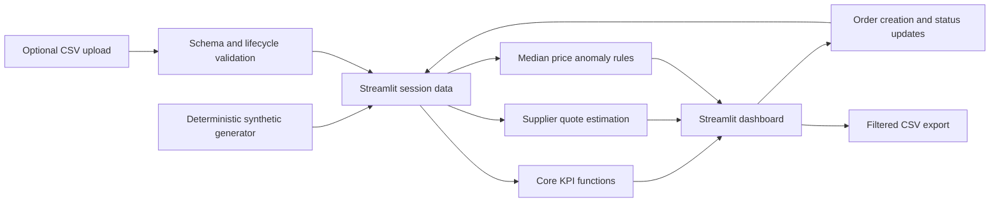

# Architecture and data flow

## Design decisions
- Python/pandas allow a transparent, inspectable proof of concept.
- Core calculation functions are isolated for automated testing.
- Streamlit session state supports demonstration interactions without a backend.
- As-of date is fixed to 2026-10-22 for reproducible synthetic snapshots.
- The price-alert rule uses within-material median price and a configurable deviation threshold.
- Quote comparison uses historical median prices, **not live quotations**.

## Production gaps
Authentication, role permissions, persistent database, audit logging, multi-user conflict handling, partial deliveries, item-level units and grade specifications, supplier API integrations, security review and observability.
